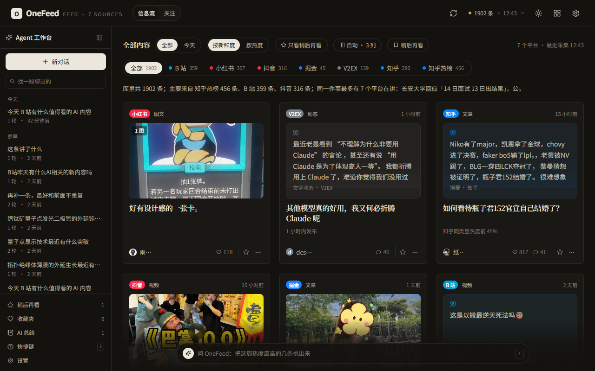
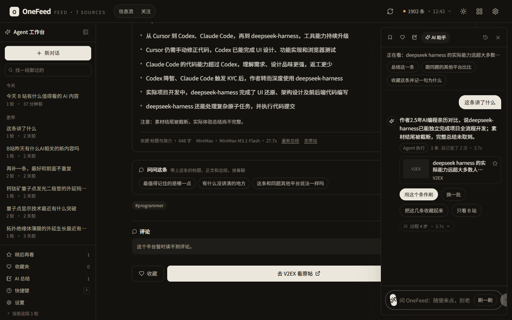

# OneFeed：把七个平台的信息流收进一屏

**AI+信息聚合赛道 · 项目简介**

队伍：Undefined　｜　队长：周铉　｜　队员：冯周杰、杨健豪

2026 年 11 月 27 日

## 一句话

OneFeed 是一个本地优先的跨平台信息聚合台：把 B 站、抖音、小红书、知乎（含热榜）、掘金、V2EX 七个来源的内容收进同一屏，用统一卡片浏览，在详情页做 AI 总结和追问，需要时一键回到原平台。

## 1. 问题

信息被平台切成了七份。想比较同一件事的不同说法，要在几个 App 之间来回跳；视频、图文、问答、动态、榜单的形态各不相同，收藏、搜索和总结互不相通。平台自带的 AI 总结通常只覆盖单条内容，不能按自己的条件跨平台筛选，也很难把“库里没有”的内容主动补进来。

现有聚合工具不少，但多数是云端 SaaS：采集在谁的机器上、登录态怎么用、数据最后去了哪里，用户看不见。对个人内容台来说，这几点恰好是最需要说清楚的。

## 2. 方案

OneFeed 由本地 Python 服务、React 前端和插件化采集器组成。

- **统一卡片**：平台、作者、时间、互动数、封面统一呈现；视频、图文、问答、动态、榜单共用一套详情页。
- **插件采集**：每个平台一个插件，在 manifest 里声明能力和对外功能；插件市场负责安装、更新、卸载。
- **AI 层**：详情页生成简洁 / 平衡 / 详细三档总结，可基于当前内容继续追问；Agent 能理解“今天 B 站有什么值得看的 AI 内容”这类跨平台条件，库里没有时主动去平台抓一轮。
- **关注流**：同步 B 站关注名单，按作者聚合动态；作者页可以补最近作品。
- **自动检查**：信息流滑到底部时，只检查当前筛选的平台；有新内容就并入首屏，并保留原来的滚动位置。
- **离线快照**：导出 63 条真实样本和封面，断网也能演示。

## 3. 现在能做到什么

截至 2026 年 11 月 27 日 12:43，信息流可见 1902 条，库内共 1935 条（含 30 条作者补档和 3 条直播动态）。

| 能力 | 现状 |
| --- | --- |
| 平台 | 7 个：B 站、抖音、小红书、知乎、知乎热榜、掘金、V2EX |
| 内容量 | 信息流 1902 条；B 站 359、小红书 307、抖音 316、掘金 45、V2EX 139、知乎 280、知乎热榜 456 |
| 浏览 | 平台 / 时间 / 排序筛选；稍后再看、收藏；三列自适应；同一事件跨平台对照（最多 7 个平台） |
| 详情 | AI 总结三档、原文、评论、作者页、原平台入口；图文灯箱从缩略图缩放展开 |
| Agent | 问答、条件筛选、自动抓取、过程折叠、停止；详情页右栏与全局工作台共用同一套会话 |
| 关注 | B 站 602 个关注账号；作者页可补最近 30 条作品 |
| 插件 | 7 个插件在线，市场支持安装、更新、卸载和错误提示 |
| 可靠性 | 平台冷却、失败重试、插件不可用降级；32 组验收脚本全部通过，CI 绿 |

## 4. 技术结构

- **后端**：Python 3.12、FastAPI、Uvicorn、SQLite。数据默认落在本机 `.onefeed/onefeed.db`，不依赖云端账号。
- **前端**：React 18、TypeScript、Vite、Tailwind CSS；用 View Transitions、framer-motion 和 Lenis 处理页面转场、共享元素和滚动。
- **插件运行时**：QuickJS 子进程沙箱执行 JS 插件，Playwright 处理需要浏览器的平台；插件通过 manifest 声明 `http` / `browser` / `cli` 能力，登录态由宿主注入，插件本身不保存账号密码。
- **AI**：通过 OpenAI 兼容接口调用，模型顺序可配置（当前 MiniMax 优先、DeepSeek 兜底），Key 存在本机，随时可以关闭。
- **交付**：GitHub 仓库提供源码与 32 组验收脚本；GitHub Pages 提供 84 条静态快照；仓库内的 `docs/submission/demo` 是 63 条离线快照，双击即可打开。

## 5. 设计与交互

顶栏只保留一枚采集胶囊：刷新时从按钮左侧长出进度，结束后自动收起，不占信息流的一行高度；点开胶囊能看到每个平台的条数、最近采集时间和失败原因。详情页的 Agent 从右栏展开，回答完成后中间过程自动折叠成“过程 N 步”，只留下结果和可继续操作的按钮。信息流保留滚动位置，筛选条件写进 URL，返回时回到原来的位置。

这些交互不是装饰。它们解决的是聚合工具最常见的三个摩擦：不知道采集有没有在跑、看完一条不知道下一步能问什么、筛完再返回就丢了位置。

## 6. 边界与合规

OneFeed 只读采集，不发布、不点赞、不评论；登录态从宿主浏览器注入，不内置任何账号密码；采集有平台级冷却，避免高频请求；插件目录在本地，可随时卸载；离线快照不包含 cookie 或私有凭据。平台条款或页面结构变化可能导致某个插件失效，失效会在设置页和采集胶囊里显式提示，不影响其他平台。

AI 使用说明：开发过程使用 DeepSeek Harness 辅助完成部分代码、测试和文档，所有提交经人工复核；运行时的 AI 总结和 Agent 可以配置模型，也可以完全关闭。

## 7. 团队分工

- **周铉（队长）**：产品与视觉设计、路演。
- **冯周杰**：后端、插件运行时、采集与数据。
- **杨健豪**：前端、交互与测试。

## 8. 链接

- 源码：https://github.com/publieople/onefeed
- Pages：https://publieople.github.io/onefeed/
- 离线演示：`docs/submission/demo/index.html`
- 项目文档：`README.md`、`docs/`

图 1　七个平台收进同一屏，顶部只保留采集胶囊。

图 2　详情页右栏的 AI 助手，回答结束后过程折叠为“过程 4 步”。
