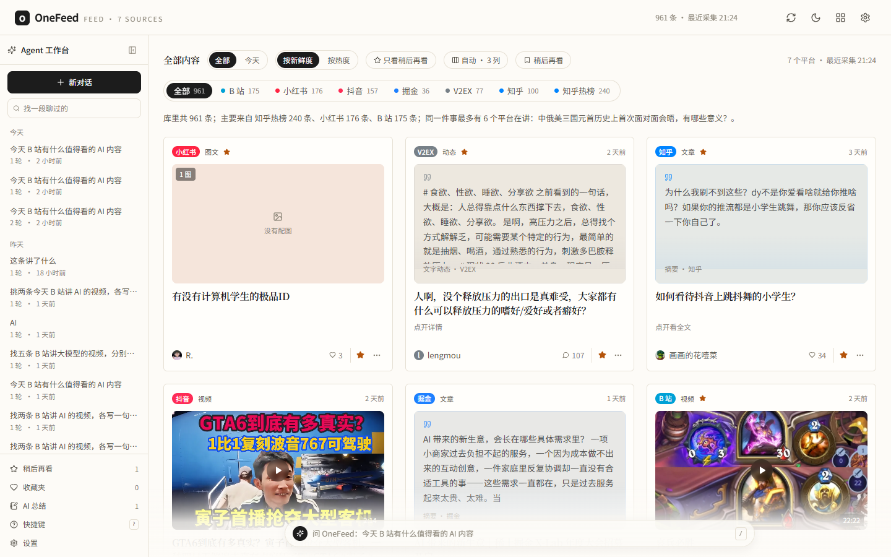
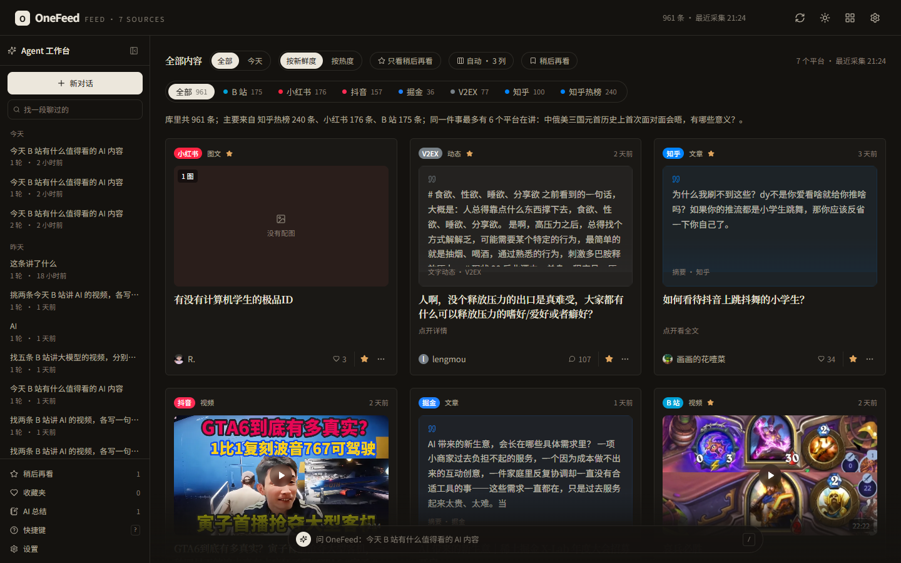

# T1「纸上」主题实装：暖纸 + 宋体标题

日期 2026-11-21。来源：用户从 [四套候选](theme-candidates-2026-11-21.md) 里选了 T1（E-Ink/Paper + Editorial Grid），要求亮暗两套都做。





---

## 一、改了什么

### 1. 色板（`web/src/theme.css`）

亮色 `:root` 整块换成纸色，新增 `--c-card`（卡片比纸亮一点，靠 2% 明度差分层）与 `--c-accent`（陶土红，只给星标、收藏心形、当前项）：

| Token | 值 | 用途 |
| --- | --- | --- |
| `--c-paper` | `253 251 247` (#FDFBF7) | 页面底 |
| `--c-card` | `255 254 251` (#FFFEFB) | 卡片底 |
| `--c-ink` | `26 26 26` (#1A1A1A) | 正文 |
| `--c-muted` | `87 83 75` (#57534B) | 次要文字（暖灰，不用冷灰） |
| `--c-fade` | `139 133 120` (#8B8578) | 时间、计数 |
| `--c-line` | `230 224 212` (#E6E0D4) | 边框（纸纤维色） |
| `--c-wash` | `244 239 228` (#F4EFE4) | 悬停、当前项底 |
| `--c-solid` / `--c-solid-fg` | `28 28 28` / 白 | 主按钮 |
| `--c-accent` | `180 83 9` (#B45309) | 星标、收藏、当前项 |

暗色 `html.dark` 是同一套关系换暖黑，不用纯黑：#14120F 底、#1A1815 卡、#ECE7DC 墨、#B3AB9D 次要、#2C2A25 线、#1F1D19 悬停、#E0A45C 强调。

阴影也跟着换暖：`--shadow-card: 0 1px 0 rgba(26,26,26,.04)`、`--shadow-pop: 0 16px 40px rgba(26,22,14,.12)`（纸上主题不用大投影）；原先散落在 7 个组件里的 `rgba(20,20,20,…)` 冷灰投影统一改成 `rgba(26,22,14,…)`（AgentComposer / AgentRail / AgentSurface / CardMenu / ScrollTop / Shell / SettingsPage）。

### 2. 字体（`web/tailwind.config.js` + `theme.css`）

- 新增 `font-display`：`"Noto Serif SC", "Songti SC", "SimSun", Georgia, serif`。本机 `C:\\Windows\\Fonts\\NotoSerifSC-VF.ttf` 已装，不下载远程字体。
- 正文栈前置 `"Noto Sans SC"`（本机已装，和 `design/theme-preview.html` 里那一屏一致）。
- 宋体只给标题：卡片标题、页面 h1、插件名、设置分区标题；正文、按钮、meta 一律无衬线。

### 3. 圆角与强调

- `borderRadius.card` 12px → 6px（纸上主题的外壳圆角小）。
- 卡片底从 `bg-paper` 改为 `bg-card`，与纸面拉开一点层次。
- 已收藏角标、页脚星标的已保存态、收藏按钮、收藏夹列表的心形：全部走 `text-accent`；顺手把 `FavoritesList` 里硬编码的 `text-rose-500/80` 也换掉（那个颜色只在旧主题里说得通）。
- 设置页左栏当前项加一条 2px 陶土色内竖线（`.nav-active` 的 `box-shadow: inset 2px 0 0 rgb(var(--c-accent))`），这是 T1 里「强调色只给当前项」的落点。

### 4. 首屏颜色

`web/index.html` 的 `theme-color` 从 `#ffffff` 改成 `#fdfbf7`；`web/src/theme.ts` 切换主题时写 `#fdfbf7` / `#14120f`。手机上地址栏不会再是纯白。

## 二、验证

```powershell
cd web; npm run build
node scripts/check-ui.mjs
uv run --with pytest python -m pytest tests -q
```

- build：`dist/assets/index-BaxXQrAa.js` 451.58 kB / gzip 143.88 kB，`index-D52VLQll.css` 51.88 kB / gzip 9.87 kB。
- check-ui：没有违规。
- pytest：116 passed。

运行时实测（Playwright，Chrome，1440×900，961 条真实数据）：

| 断言 | 实测 |
| --- | --- |
| 卡片底 | `rgb(255, 254, 251)` |
| 卡片圆角 | `6px` |
| 卡片标题字族 | `"Noto Serif SC", "Songti SC", SimSun, Georgia, serif` |
| 星标（已保存）颜色 | `rgb(180, 83, 9)` |
| 页面底 | `rgb(253, 251, 247)` |
| `--c-accent` / `--c-paper` | `180 83 9` / `253 251 247` |

暗色走同一份变量，只换 `html.dark` 那一块，所以 `design/theme-preview.html` 里那张夜间版是照着实现的。

## 三、边界与没做的

- **只做一套主题**，不做运行时主题选择器。切主题仍是原来的亮/暗两档（顶栏按钮 + `t` 键），View Transition 的斜带扫过保留。
- **平台色没动**：B 站粉、小红书红、抖音红、掘金蓝、知乎蓝这些品牌色在暖纸上依然是全页唯一的高饱和色，这是 T1 成立的前提。
- **动效没动**：uupm 对 E-Ink 风格建议「sharp transitions, no fade」，跟现有 260ms 宽度补间、共享元素转场冲突，不采纳。
- **阴影没有全删**：纸主题理论上无阴影，但浮层（AI 面板、卡片菜单、右栏抽屉）在暖白上需要一点分离度，保留一层很浅的暖投影。
- 没做：字体子集化（Noto Serif SC 走系统字体，不打包）、打印样式、`prefers-contrast` 适配。

## 四、回滚

色板与字体全在 `web/src/theme.css` 的 `:root` / `html.dark` 两块，加上 `tailwind.config.js` 的 `fontFamily.display` 与 `borderRadius.card`。要回旧主题，还原这三处 + 把 `bg-card` 改回 `bg-paper` 即可，组件逻辑没有分叉。
